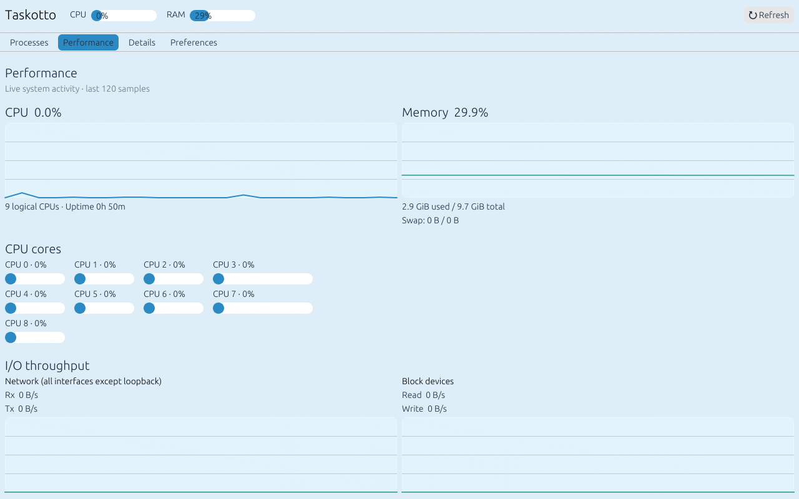
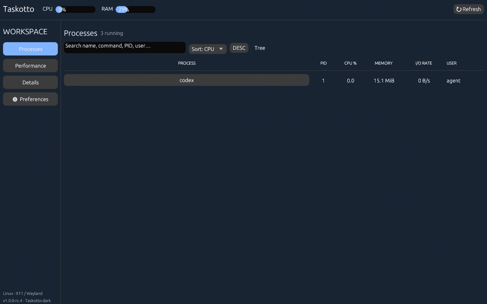
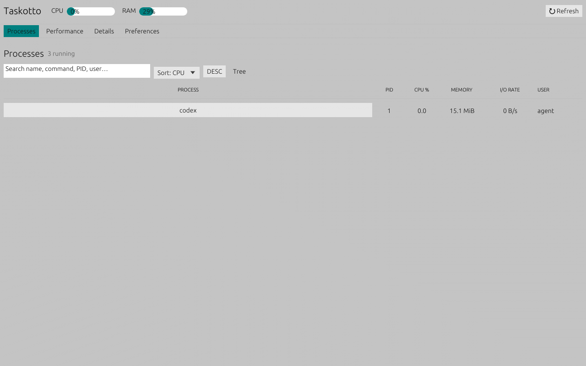

<div align="center">

# 🍚 Taskotto

**The Linux task manager, served your way.**

A customizable process manager and system monitor written in **Rust**. Runs alone or alongside [RiceBowl](https://github.com/CopyPasteUser/Ricebowl) on **X11 and Wayland**.

  

</div>

> **Status:** `1.0.0-rc.4` — the 1.0 code scope is implemented; final X11/Wayland GUI and resource-use acceptance remain. See [roadmap](ROADMAP.md) and [QA checklist](QA.md). This is **not yet stable 1.0**.

## Screenshots

**Windows 10-inspired process view** — grouped processes, usage heatmap and familiar task-manager navigation.


**XP Luna-inspired performance view** — original blue/cream chrome and green history graphs.


<details>
<summary>More screenshots: performance, processes and other rices</summary>








</details>

*Real Taskotto egui rendering with live Linux `/proc` readings, captured headlessly; the isolated test environment exposes only a few processes. Native X11/Wayland window captures are still pending. [Capture details](SCREENSHOTS.md) · [Rice fidelity and boundaries](RICE_FIDELITY.md).*

## What works

- **Processes:** searchable live list, CPU/RAM/I/O/PID/name sort, tree, user filter, process start/runtime and per-process I/O rates.
- **Safe actions:** terminate, force kill, pause and resume with confirmation and PID-reuse protection via Linux `pidfd`.
- **Performance:** CPU/core load, RAM/swap, network RX/TX and disk read/write rates, bounded comparative rolling graphs.
- **Riceable:** 8 profiles, including distinct Windows 10-inspired and XP Luna-inspired task-manager layouts; custom colors, layout, spacing, fonts, table columns/row height, density and persistent TOML preferences.
- **Independent:** no root service, no resident daemon, no RiceBowl or desktop-shell dependency.
- **Headless:** `--snapshot --json` is available without a graphical session.

<details>
<summary>Available Rice themes</summary>

Taskotto dark, Classic 98, XP Luna, Windows 7, Windows 10, Frutiger Aero, ChromeOS and macOS-inspired. All assets are original; no proprietary OS icons are included.

</details>

## Build and run

Requires Linux, Rust 1.88+ and a working X11 or Wayland session with OpenGL support.

```bash
git clone https://github.com/CopyPasteUser/Taskotto.git
cd Taskotto
cargo run --release
```

The first compilation may take a while because of the GUI toolkit. Later starts do not recompile.

### Install for your user

```bash
cargo install --path . --locked
taskotto --install-desktop
```

The installer creates a user-local application entry with the executable's absolute path, so the menu does not depend on your graphical session's `PATH`. Then launch **Taskotto** from the applications menu.

## Controls

| Action | Shortcut / command |
| --- | --- |
| Search processes | `Ctrl+F` |
| Refresh immediately | `F5` |
| Clear search / dismiss confirmation | `Esc` |
| Show system snapshot | `taskotto --snapshot` |
| JSON snapshot | `taskotto --snapshot --json` |
| Choose a rice | `taskotto --theme xp-luna` |
| Reduce polling | `taskotto --refresh-ms 5000` |

Select a process to see **Details** and signal actions. A confirmation dialog appears before any signal. Taskotto uses only the permissions of the current user and refuses signals to PID 1 and itself.

### RiceBowl integration

RiceBowl can pass its current rice when launching Taskotto:

```bash
RICEBOWL_RICE=windows7 taskotto
```

The `--theme` flag overrides this environment variable. Launcher-selected themes are **session-only**: other preference changes do not overwrite the saved theme. Preferences live at `~/.config/taskotto/config.toml` or the XDG config location. No external service or theme assets are needed.

### Custom design tokens

The Preferences page offers color, typography, density, spacing, corner and navigation controls. RiceBowl or another theme generator can also write these settings as TOML (other preferences can be omitted):

```toml
theme = "windows7"
layout_mode = "top-tabs" # auto, sidebar, top-tabs
density = "compact"
accent_hex = "#2179BC"
surface_hex = "#E8F2FA"
text_hex = "#26394F"
font_scale = 1.05
ui_spacing = 7.0
corner_radius = 5
show_io_column = true
show_user_column = true
table_row_height = 30.0
```

Unreadable text colors automatically fall back to a contrasting color. Invalid settings are reported; if a malformed config is replaced, its original contents are backed up in the same directory.

## Development

```bash
cargo fmt --all -- --check
cargo clippy --locked --all-targets -- -D warnings
cargo test --locked --all-targets
cargo build --locked --release
```

- [Roadmap to 1.0](ROADMAP.md) — milestones, acceptance gates and deferred enhancements.
- [Hardware QA checklist](QA.md) — X11/Wayland, process safety and measured resource use.
- [Performance measurements](PERFORMANCE.md) — reproducible headless baseline and GUI acceptance limits.
- [Screenshot provenance](SCREENSHOTS.md) — reproducible live-data renders and their limitations.
- [Windows 10 and XP Luna rice details](RICE_FIDELITY.md) — layout, interaction and fidelity boundaries.
- [Release candidate notes](RELEASE_NOTES.md) — implemented scope, verified checks and known limitations.
- [Contributing](CONTRIBUTING.md) · [Security policy](SECURITY.md) · [Changelog](CHANGELOG.md)
- [RiceField](https://github.com/CopyPasteUser/Ricefield) — matching standalone Rust file manager.

**Limitations:** Linux only. The first sample has no historical CPU/I/O baseline. Per-process I/O depends on `/proc/<PID>/io` permissions; restricted entries report unavailable. Disk rates are block-device totals, and network rates sum interfaces excluding loopback (virtual interfaces can double-count traffic). Kernel 5.3+ is required for safe process signals; monitoring works on older kernels. GPU monitoring and container-specific views are future extensions.

MIT licensed. © 2026 CopyPasteUser.
