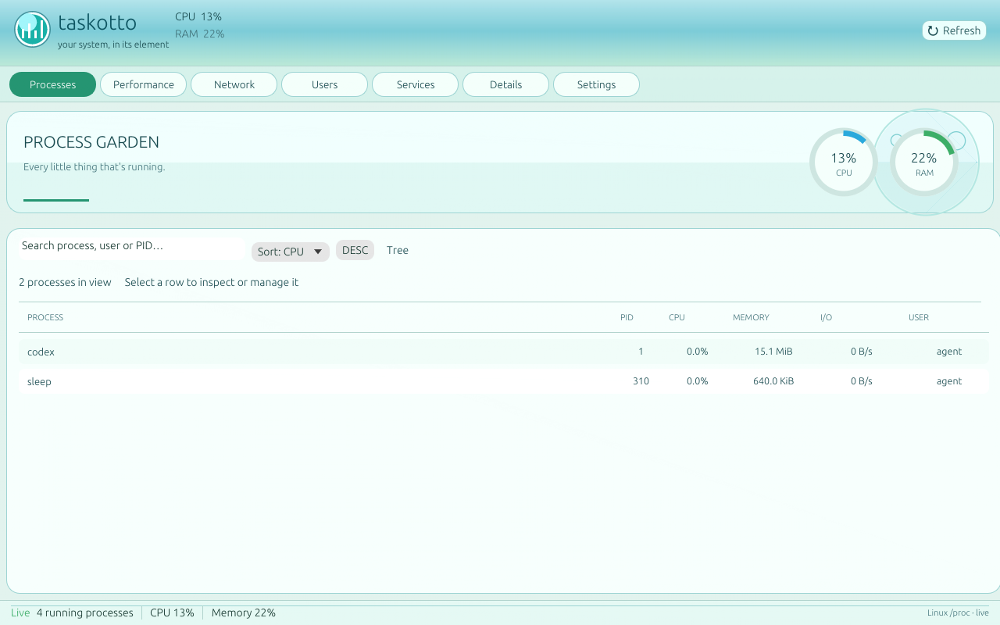
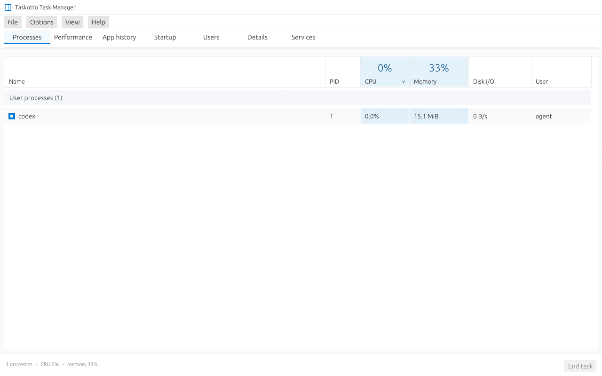

<div align="center">

# 🍚 Taskotto

**A Linux task manager with a desktop personality.**

A standalone **Rust** process manager and system monitor for X11 and Wayland, with seven OS-inspired interfaces and custom RicePacks. Optionally integrates with [RiceBowl](https://github.com/CopyPasteUser/Ricebowl).

[Gallery](SCREENSHOT_GALLERY.md) · [1.0 roadmap](ROADMAP.md) · [Hardware QA](ACCEPTANCE_1_0.md) · [RicePack format](RICEPACK_FORMAT.md)

</div>

| Frutiger Aero | Windows 10 |
| :---: | :---: |
| [](assets/screenshots/taskotto-frutiger-aero-processes.png) | [](assets/screenshots/taskotto-win10-processes.png) |

[See all 52 captured screens](SCREENSHOT_GALLERY.md), including Windows 98, XP Luna, Windows 7, ChromeOS, macOS and custom dashboards.

## Features

- **Processes:** live CPU/RAM/I/O data, search, filtering, tree view and confirmation-protected process actions with PID-reuse checks.
- **System monitoring:** CPU, memory, network, disk, PSI, available GPU and battery sensors; missing readings are shown as unavailable.
- **Process inspection:** cgroup details, on-demand PSS measurements, bounded process history and explicit CSV/JSON export.
- **Seven built-in styles + custom layouts:** RicePack TOML themes, screen designer and live appearance reload without a desktop-shell dependency.
- **Lightweight operation:** adjustable sampling, optional low-overhead mode, no root service or resident daemon; headless JSON snapshots are supported.

**Status:** `1.0.0` — first stable release, approved by the project owner after several days of everyday use (9 November 2026). The original cross-desktop test matrix and quantified GUI performance benchmarks were not individually submitted, so they remain documented follow-up checks. Window borders and title buttons remain the responsibility of the window manager.

## Install and run

Requires Linux, **Rust 1.88+** and an X11 or Wayland session with OpenGL.

```bash
git clone https://github.com/CopyPasteUser/Taskotto.git
cd Taskotto
bash install.sh
```

The user-local installer creates an applications-menu entry. To run directly from source instead:

```bash
cargo run --release
```

Useful commands:

```bash
taskotto --theme frutiger-aero
taskotto --snapshot --json
taskotto --check-ricepack examples/ricepacks/sea-glass.toml
RICEBOWL_RICE=windows7 taskotto
```

For a custom RicePack, use `taskotto --ricepack PATH`; it does not execute scripts or overwrite your saved theme. Process signals always require confirmation and use the current user's permissions.

## Development and docs

```bash
cargo fmt --all -- --check
cargo clippy --locked --all-targets -- -D warnings
cargo test --locked --all-targets
```

[Complete screenshot gallery](SCREENSHOT_GALLERY.md) · [Capture provenance](SCREENSHOTS.md) · [Design fidelity](RICE_FIDELITY.md) · [Performance tests](PERFORMANCE.md) · [QA checklist](QA.md) · [1.0 release notes](RELEASE_1_0_0.md) · [Changelog](CHANGELOG.md) · [MIT License](LICENSE)
